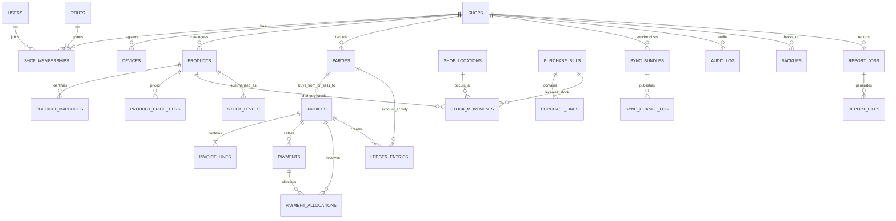

# ShopBill — Backend Database Schema

**Version:** 1.0 (baseline draft)  
**Target:** PostgreSQL 16+, FastAPI, SQLAlchemy 2, Pydantic v2, Alembic  
**Product baseline:** ShopBill PRD / TRD / APPFLOW / UI-UX specifications, 26 October 2026

> The companion `shopbill_backend_schema.sql` is the concrete PostgreSQL DDL baseline. Use Alembic migrations in the application repository instead of executing repeated schema changes manually. This schema intentionally includes Phase 1 core tables plus Phase 2 and Phase 3 support tables so future features do not require redesigning the main entities.

## 1. Architectural rules represented in the schema

1. **Offline-first:** the PWA's Dexie/IndexedDB database remains the source of truth while a device is offline. PostgreSQL is the cloud replica/sync hub, backup target, reference-data source, and report factory.
2. **Tenant isolation:** every business record carries `shop_id`; PostgreSQL row-level security (RLS) uses transaction-local `app.shop_id`. Application authorization checks must also confirm membership and permissions.
3. **Stable identifiers:** the API/client supplies UUIDv7 identifiers. Do not use auto-incrementing IDs for business entities or assume IDs encode event order.
4. **Financial precision:** monetary amounts are integer paise (`*_paise`), GST rates are basis points (`*_bps`; 18% = 1800), and quantities are integer thousandths (`*_milli`; 1.500 kg = 1500). Do not use floating-point types for prices or tax.
5. **Immutable business events:** finalized invoices are not editable or deletable. Payments, stock movements, ledger entries, audit events, sync changes and provider webhooks are append-only; corrections use cancelling/reversal events, credit notes, or debit notes.
6. **Auditable tax math:** invoice lines persist the product name, HSN/SAC, unit, tax treatment, rate, prices, discounts and computed amounts as snapshots. GST engine and reference-bundle versions are stored on the invoice.
7. **Safe retries and sync:** business events carry a unique `source_event_key`; API writes use idempotency records; sync push uses a transaction bundle with a hash and a stored response.
8. **Derived totals:** stock quantities and party balances are rebuilt or queried from append-only events. `stock_levels` is a derived read model, not the authoritative movement history.

## 2. High-level relationship diagram

The diagram is a domain-level view, not a complete list of every foreign key. The SQL DDL is authoritative for columns, indexes, constraints and RLS policies.

## 3. Table catalogue

### A. Identity, tenant configuration and access control

| Table | Responsibility | Phase |
|---|---|---|
| `shops` | Tenant/shop profile, tax scheme, state, GSTIN, financial-year start, invoice prefix, UPI and language | 1 |
| `users` | Global identity, password hash, verified contact fields and account status | 1 |
| `roles` | Shop-scoped roles such as Owner, Admin, Cashier and Accountant | 1 |
| `permission_catalog` | Global permission key dictionary | 1 |
| `role_permissions` | Permission assignment to a shop's roles | 1 |
| `shop_memberships` | User-to-shop membership, role, invitation and revocation | 1 |
| `shop_locations` | Shop branches/stock locations; single default location for MVP | 1/2 |
| `devices` | Registered PWA devices, device-specific invoice series and sync cursor | 1/2 |
| `refresh_token_families` | Groups refresh tokens to support family revocation after token reuse | 1 |
| `refresh_tokens` | Stores only token hashes and rotation/revocation metadata | 1 |
| `login_attempts` | Login throttling, lockout calculation and abuse investigation | 1 |
| `api_idempotency_records` | Request hash, cached status/body and expiry for idempotent write retries | 1 |

### B. Reference data and tax configuration

| Table | Responsibility | Phase |
|---|---|---|
| `states` | GST state/UT codes and names | 1 |
| `gst_rates` | Effective-dated tax and cess rates | 1 |
| `hsn_codes` | HSN/SAC descriptions, minimum digits and version/effective dates | 1 |
| `reference_bundles` | Signed reference bundle metadata, ETag, checksum, signature and object key | 1 |

Reference tables are global rather than tenant-owned. Each invoice line still stores tax snapshots so future rate changes cannot rewrite historical bills.

### C. Products and parties

| Table | Responsibility | Phase |
|---|---|---|
| `product_categories`, `brands`, `units` | Product classification and units | 1; expanded in 2 |
| `products` | SKU, multilingual names, HSN/SAC, tax treatment/rates, prices, minimum stock and HLC fields | 1 |
| `product_barcodes` | Multiple unique barcodes per product/shop | 1 |
| `product_price_tiers` | Retail/wholesale/customer-specific tiers | 2 |
| `product_batches` | Batch numbers, expiry date and batch MRP | 2 |
| `product_serials` | Serial/IMEI tracking | 2 |
| `parties` | Unified customer/supplier directory with GSTIN, addresses, language and credit limit | 1 |

Product archive is soft (`is_archived`) so historical invoice snapshots stay intact. Product and party master-data synchronization uses the Hybrid Logical Clock fields (`hlc_physical_ms`, `hlc_counter`, `hlc_node_id`).

### D. Billing, payments, purchases, stock and ledgers

| Table | Responsibility | Phase |
|---|---|---|
| `document_counters` | Per-series, document-type and financial-year next sequence | 1 |
| `held_bills` | Recoverable POS draft/cart snapshots | 1 |
| `invoices` | Final document header, series/number, tax totals, party/shop snapshots, cancellation and original-invoice link | 1 |
| `invoice_lines` | Immutable line-level product/tax/price/discount snapshots | 1 |
| `payments` | Cash/UPI/card/cheque/credit tenders, receipts and refunds; append-only | 1 |
| `payment_allocations` | Allocates a receipt to one or more open invoices | 1/2 |
| `purchase_bills` | Supplier invoice header and totals | 1 |
| `purchase_lines` | Purchase-line item, quantity, tax and cost snapshots | 1 |
| `stock_movements` | Immutable stock delta events for sales, inward, returns and adjustments | 1 |
| `stock_levels` | Derived on-hand/reserved/sellable quantity by location and product | 1 |
| `ledger_entries` | Append-only customer receivable and supplier payable activity | 1 |
| `day_close_sessions` | Expected versus physically counted drawer cash and UPI summary | 1 |

A return should create a linked credit note/return document and reversal events; it must not edit the original invoice. The service must verify cumulative returned quantity against the original line quantity before posting the return.

### E. Audit, sync, backup and reports

| Table | Responsibility | Phase |
|---|---|---|
| `audit_chain_heads`, `audit_log` | Per-shop sequence and hash-chained audit events | 1; hash chaining from sync/security phase |
| `sync_bundles` | Idempotent inbound bundle receipt and processing result | 2 |
| `sync_change_log` | Server-ordered change stream for device pull cursors | 2 |
| `backups` | Encrypted backup metadata; bytes live in S3-compatible object storage | 1 skeleton; automation in 2 |
| `report_jobs`, `report_schedules`, `report_files` | On-demand/scheduled report lifecycle, delivery config and expiring object metadata | 1 skeleton; automation in 2 |
| `worker_jobs`, `worker_job_runs`, `dead_letter_jobs` | Durable job queue metadata, retry history and terminal failures | 2 |

### F. Messaging, AI, data rights and compliance

| Table | Responsibility | Phase |
|---|---|---|
| `notification_consents` | Explicit channel/purpose consent history | 2 |
| `messages` | Reminder/report delivery state and provider references | 2 |
| `assistant_conversations`, `assistant_messages` | Optional assistant history with structured grounded tool results | 2 |
| `purchase_attachments` | Purchase-bill image object metadata and OCR draft result | 2 |
| `data_requests` | Export/erasure request lifecycle | 2 |
| `compliance_submissions` | E-invoice/e-way-bill adapter request/response lifecycle | 3 |
| `payment_webhook_events` | Provider event idempotency and webhook processing metadata | 3 |

## 4. Important field conventions

| Convention | Rule |
|---|---|
| Primary keys | UUIDv7 generated at the edge/API; every relevant entity also has `UNIQUE (shop_id, id)` for composite tenant-scoped foreign keys |
| Money | `bigint` paise only; `₹1.00` is stored as `100` |
| GST | Basis points, where 10000 = 100%; 5% = 500 and 18% = 1800 |
| Quantity | Integer thousandths; `1.500 kg` is `1500` |
| Time | `timestamptz` stored in UTC; scheduled reports use `Asia/Kolkata` as the schedule timezone |
| Addresses/snapshots | `jsonb` where the shape may evolve; invoice and supplier/customer snapshots are frozen at posting time |
| Object storage | Store object keys, hashes, encryption/status/expiry in PostgreSQL; store file bytes in S3-compatible storage, namespaced by shop |
| Event de-duplication | Unique `(shop_id, source_event_key)` on bill/payment/stock/ledger sources; unique client bundle id on sync receipts |
| Pagination | API cursor pagination, default 100 items and maximum 500; use indexed stable ordering, not offset pagination for large event lists |

## 5. Financial and inventory invariants

The application/service layer and tests must enforce these invariants in addition to SQL constraints:

- Invoice header: `grand_total_paise = taxable_value_paise + cgst_paise + sgst_paise + utgst_paise + igst_paise + cess_paise + round_off_paise`.
- Invoice line: `line_total_paise = taxable_value_paise + cgst_paise + sgst_paise + utgst_paise + igst_paise + cess_paise`.
- Composition dealers issue Bills of Supply with tax zeroed according to the approved GST rules.
- GST engine versions, effective rate/reference versions and HSN/tax snapshots are attached to finalized documents.
- Invoice numbers are unique per shop/series/document type/financial year and are never reused. A cancellation retains the original number.
- Payment receipts, stock movements, ledger entries and sync events are append-only. Reversal requires an additional event.
- `stock_levels` is rebuildable from `stock_movements`; party balances are derived from `ledger_entries` (with documented debit/credit semantics per party type).
- Sync push applies the entire business bundle atomically, verifies event uniqueness and recalculates invoice math through the Python verifier before acceptance.
- Audit hash computation and head advancement must occur in one database transaction while locking that shop's `audit_chain_heads` row.

GST outcomes should be verified against shared golden vectors and reviewed by a Chartered Accountant before production. This schema stores results and snapshots; it does not itself implement the GST calculation engine.

## 6. RLS and API transaction contract

For every authenticated tenant request:

1. Authenticate the access JWT and validate its device binding.
2. Verify active `shop_memberships`, active device and role permission in application code.
3. Begin a database transaction and set the authorized tenant context using `SET LOCAL app.shop_id = '<shop UUID>'` (or `set_config('app.shop_id', ..., true)`).
4. Execute repository operations inside that transaction. Do not accept `shop_id` as authoritative from a request body; derive it from the authenticated context.
5. Commit/rollback, clearing the transaction-local setting automatically.

Use a non-owner API database role and do not grant `BYPASSRLS`. The table owner and superusers can bypass ordinary RLS protections; production roles and migrations must be separated. Shop creation/login and webhook intake happen before an ordinary tenant context exists, so give those flows narrow, separately reviewed service access rather than broad tenant-table access.

`api_idempotency_records`, `login_attempts`, `worker_jobs`, `worker_job_runs`, `dead_letter_jobs`, and `payment_webhook_events` are cross-cutting service tables and are intentionally not included in the tenant RLS loop in this baseline. Grant them only to the API/worker roles, and scope reads by a server-generated key or verified provider/shop mapping. Do not expose them directly to shop users.

## 7. API areas mapped to the schema

| API area | Tables primarily used |
|---|---|
| `POST /v1/auth/shops` | `users`, `shops`, `roles`, `role_permissions`, `shop_memberships`, `shop_locations` |
| `POST /v1/auth/login`, `/refresh`, `/logout`, `/me` | `users`, `shop_memberships`, `devices`, `refresh_token_families`, `refresh_tokens`, `login_attempts` |
| `POST /v1/devices`, revoke device | `devices`, `refresh_token_families`, `refresh_tokens` |
| `GET /v1/reference/manifest`, `/reference/{bundle}` | `reference_bundles`, `gst_rates`, `hsn_codes`, `states` |
| `POST /v1/backups`, `GET/DELETE /v1/backups` | `backups` plus S3-compatible object storage |
| `POST /v1/sync/push`, `GET /v1/sync/pull`, `/snapshot` | `sync_bundles`, business tables, `sync_change_log`, `devices` |
| Products, barcode and stock | `products`, `product_barcodes`, `product_categories`, `brands`, `units`, `stock_movements`, `stock_levels` |
| POS billing / returns | `invoices`, `invoice_lines`, `payments`, `payment_allocations`, `stock_movements`, `ledger_entries`, `document_counters`, `audit_log` |
| Purchases / suppliers | `purchase_bills`, `purchase_lines`, `stock_movements`, `ledger_entries`, `purchase_attachments` |
| Day close / dashboard | `day_close_sessions`, `invoices`, `payments`, `stock_levels`, `ledger_entries` |
| Report jobs / schedules / downloads | `report_jobs`, `report_schedules`, `report_files`, `worker_jobs` |
| Notifications / reminders | `notification_consents`, `messages`, `parties`, `ledger_entries` |
| Assistant | `assistant_conversations`, `assistant_messages`; read-only, shop-scoped query tools over business tables |
| GSTR / e-invoice / e-way bill / payment webhooks | `invoices`, `invoice_lines`, `compliance_submissions`, `payment_webhook_events`, `payments` |
| Data export/erase | `data_requests`, `backups`, `report_files`, and tenant data per the approved retention policy |

## 8. Recommended migration order

1. Global enums and reference tables (`states`, `gst_rates`, `hsn_codes`, `reference_bundles`).
2. Identity and tenant tables (`users`, `shops`, roles, memberships, locations, devices, refresh-token tables).
3. Catalogue and parties (`categories`, `brands`, `units`, products/barcodes, parties).
4. Numbering and documents (`document_counters`, held bills, invoices, invoice lines, payments and allocations).
5. Purchases, stock, ledger and day-close tables.
6. Audit chain, idempotency, sync receipts/change stream, backup and reporting tables.
7. Messaging, AI/OCR, data requests and Phase 3 compliance tables.
8. RLS policies, immutable-event triggers, seed permissions/roles, grants, indexes and migration tests.

## 9. Before production launch

- Review GST assumptions and invoice/credit-note behavior with a CA; test inclusive pricing, discounts, inter-state/intra-state splits, UTGST, cess, composition, returns, cancellation and rounding against golden fixtures.
- Add deployment-specific grants and test RLS with at least two shops using the real API database role. Verify reads, inserts, updates and foreign keys cannot cross tenants.
- Implement Alembic migration tests from a clean database and from each released schema version.
- Add API-level idempotency-key enforcement (including request-hash mismatch behavior) and enforce the 24-hour replay window.
- Implement token rotation/reuse detection, per-IP/account login throttling, per-user limits and per-device sync limits in the service layer.
- Implement database-safe audit hashing, atomic bundle application, server-assigned `received_at`, HLC conflict resolution and stock/ledger rebuild integrity jobs.
- Configure object storage encryption, per-shop key namespaces, 10-minute pre-signed download URLs, report expiry after 90 days, backup retention and verified restore drills.
- Add tests for append-only triggers and invoice immutability. Exercise every cancellation/return path and confirm no original invoice is edited.
- Review personal-data retention and erasure handling; keep only data required for legal/audit obligations and documented product behavior.

## 10. Scope notes and deliberate boundaries

- The schema supports all three planned phases, but Phase 2/3 tables can be deployed in later Alembic revisions when those features are implemented.
- ShopBill's Phase 1 reporting is primarily generated locally in the browser; server report tables prepare the Phase 2 scheduled-report pipeline.
- The database does not replace the pure TypeScript GST engine. The Python verifier is a second implementation for synced invoices and must pass the same golden test vectors.
- Payment gateway, WhatsApp/SMS/email, IRP/GSP and AI integrations are adapter-based; the schema records lifecycle/state, not provider implementation details.
- Branch stock, batches, serials and tier pricing are modeled for Phase 2. For MVP-only deployment, these can be left unused while keeping a default stock location.
